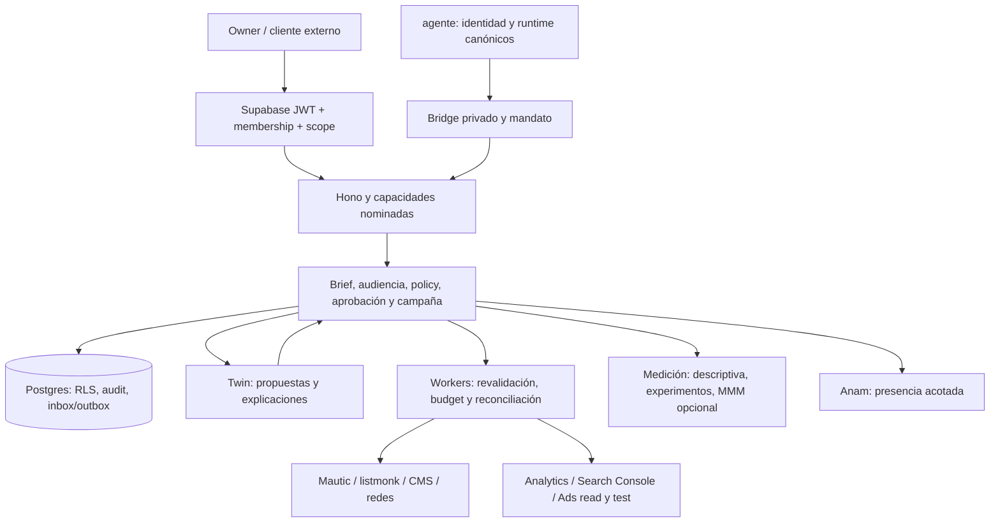

# Arquitectura y autoridad por efecto

Stack propuesto TypeScript/Hono/pnpm, core de DTO/policy/FSM, Postgres/Supabase, workers/outbox y adaptadores de negocio. Python/R solo como procesos estadísticos aislados opcionales, no una reescritura del padre. No se ha implementado este esquema.

## Fronteras

La organización operadora emplea agentes canónicos; cada tenant del SaaS es una empresa cliente aislada. BrandWorkspace/proyecto/campaña están dentro de un tenant. Las personas de una audiencia no son usuarios Supabase ni miembros por importarse a una lista. Un colaborador de agencia tiene permisos de proyectos/recursos explícitos, no acceso universal. Compartir una marca/dominio entre tenants no fusiona datos.

Un empleado del operador puede trabajar para un tenant objetivo mediante mandato: conservar Actor.tenantId de origen y data-scope objetivo separados. Ningún body/prompt del cliente prueba esa delegación. El portal externo evita que el cliente necesite usar la UI AgntiaPro; no elimina el vínculo canónico del equipo especialista. Un twin puede ejecutar trabajo local dentro de un lease válido; no necesita llamar al padre por cada inferencia, pero tampoco asumir autoridad indefinida si el mandato vence.

## AuthorityMap

| Entidad/efecto | Autoridad propuesta | Proyección permitida |
|---|---|---|
| Agente/rol/persona/runtime | Padre | TwinBinding y configuración especializada versionada |
| Usuario, membresías y proyecto | Supabase+directorio/policy verificados | Principal mínimo hacia servicio y workers |
| Datos de personas/consentimiento | Custodio declarado por campo/propósito; ledger local de prueba | Snapshot mínimo hacia motor autorizado |
| Brief y aprobación campaña | Marketing/humano según acuerdo | BrandPolicy/fuentes/scope congelados |
| Marca/creatividad | Branding o módulo local elegido | Asset/version/derechos, no prompt mutable como fuente única |
| Publicación social | Redes o adaptador nombrado | Un único OutboundIntent y receipt |
| Email/journey | Un solo executor por intento/paso | Backend no amplía audiencia ni cambia finalidad |
| Compra de medios | Puerto futuro explícitamente autorizado | Plan/recomendación nunca equivale a gasto |
| Ventas/ingreso/coste | Fuente de negocio autorizada | Conversión/venta con definición, dedup y ajustes |
| Rota empresarial | Padre | Eventos/tareas reales; jobs técnicos no crean otro scheduler |

Se permite duplicación funcional. Un WorkOrder puede usar módulos locales aunque no exista un hermano; debe declarar quién decide y ejecuta. Una tarea de marketing que genera un borrador para redes no publica por sí sola. Un evento del CRM no inscribe automáticamente al contacto en una secuencia.

## Persistencia y procesamiento

Entidades tenant-scoped: agreements/work_orders/brand_policies; contacts/processing_basis/preferences; audience_rules/snapshots/eligibility_decisions; briefs/plans/assets/claims; campaign_revisions/approvals/journey_runs/steps; outbound_intents/attempts/receipts; integration_connections/links/cursors/conflicts; observations/conversions/experiment_specs/model_runs/report_snapshots; budgets/reservations; jobs/inbox/outbox/audit. FKs/índices compuestos por tenant; IDs de proveedor strings opacos.

Commit local incluye estado, historia, idempotency y outbox. HTTP externo no comparte transacción; incertidumbre necesita reconciliación. Los snapshots permanecen versionados, y cambios de fuente pueden invalidar propuestas/aprobaciones sin reescribir el pasado. No exportar identidades de audiencia al bus o al modelo para explicar una métrica agregada. Observar cardinalidad/propósito desde ingestión hasta informe.
